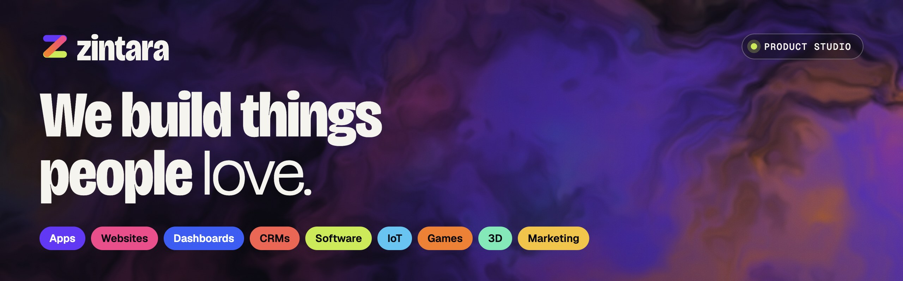

  

**Zintara is a small, senior product studio.** Design, code, hardware and growth sit at one table, so your idea goes from napkin to app store, browser, console or shelf without getting lost between agencies.

### What we build

| Service | What it covers |
| --- | --- |
| **Apps** | iOS and Android apps that feel native, built cross-platform or fully native when the product needs it. |
| **Websites** | Fast marketing sites and full web apps, from the first wireframe through hosting, analytics and SEO. |
| **Custom dashboards** | Live dashboards and admin panels that pull every number you care about into one screen. |
| **CRMs** | CRMs built around how you actually sell: custom pipelines, automations and integrations. |
| **Software** | APIs, data pipelines, integrations and internal tools built to last. |
| **IoT** | Connected devices that talk to the cloud: firmware and hardware integration. |
| **Games** | Mobile, PC and web games in 2D and 3D, with tight game feel and builds that ship. |
| **3D modelling** | Characters, products and environments, optimised for games, renders, web and AR. |
| **Marketing** | Positioning, branding, content and paid growth for the products we build and the ones you already run. |

### Selected work

- **Self-hosted AI avatar video.** A script and one photo in, an MP4 of that person speaking it in their cloned voice out. Open-weight models on our own pay-per-second GPUs, at roughly $6–30 per 15-minute video instead of ~$144 on a closed API.
- **Zintara Games.** 32 casual games from one Godot 4 monorepo, 15 of them in Google Play testing.
- **Avatar reels pipeline.** A PDF of ad scripts in, edited 9:16 reels out: avatar takes, B-roll, karaoke captions and a DaVinci Resolve edit.
- **Digital wedding invitation.** A mobile-first, animated invite with AI-made art, video and music.

### How we work

**Discover** → **Design** → **Build** → **Launch & grow**. Working software every week, clear scopes, honest timelines, and clean code and assets you own from day one.

### Start a project

Tell us what you're building at **[zintara-studio.vercel.app](https://zintara-studio.vercel.app/#contact)**. A few lines is plenty.
Or follow along on Instagram: **[@zintara.studio](https://www.instagram.com/zintara.studio/)**.
